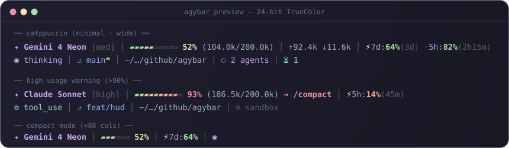

<div align="center">


**Google Antigravity CLI (`agy`) 向けの高速・高デザイン・依存関係ゼロな Go 製ステータスライン＆使用量モニター。**

<p>
  <a href="https://github.com/zhouyg1992/agybar/releases"></a>
  <a href="./LICENSE"></a>
  <a href="https://go.dev/"></a>
  
  <a href="https://github.com/zhouyg1992/agybar/actions/workflows/ci.yml"></a>
</p>

<p>
  <a href="./README.md">English</a> ·
  <a href="./README.zh-CN.md">简体中文</a> ·
  <strong>日本語</strong> ·
  <a href="./README.ko.md">한국어</a>
</p>



</div>

---

## 主な機能

- **依存関係ゼロ＆ミリ秒起動** — 単一の静的 Go バイナリ。`agy` の操作感を損なわず瞬時に描画します。
- **4 種類の 24-bit TrueColor テーマ** — `catppuccin`（デフォルト）、`tokyo-night`、`nord`、`mono`。
- **2 つのビジュアルスタイル** — `minimal`（純 Unicode でどの端末でもそのまま綺麗に表示）と `pill`（Nerd Font 対応のカプセル型）。
- **3 種類のグラデーション・プログレスバー** — `blocks`（`▰▱`）、`smooth`（`━╸─`）、`braille`（`⣿⣤⣀`）。使用率に応じて色が変化し、`90%` 以上で自動的に `→ /compact` を提案します。
- **レスポンシブレイアウト** — `terminal_width` を検知し、広い画面では 2 行、狭いペイン（`<88` 桁）では自動的に 1 行のコンパクト表示へ切り替わります。
- **豊富な `agy` テレメトリ** — モデル名・推論強度、コンテキスト使用率とトークン数（`↑in ↓out`）、クォータ残量とリセットまでのカウントダウン、エージェント状態、Git ブランチ、サブエージェント数、バックグラウンドタスク、サンドボックス状態を表示。

---

## インストール

### 方法 1：ワンライナー・インストーラー（推奨）

GitHub Releases から最新プラットフォーム向けビルド済みバイナリ（SHA-256 検証付き・Go 不要）をダウンロードし、`~/.gemini/antigravity-cli/settings.json` の設定と `agy` プラグイン登録を自動で行います：

```bash
curl -fsSL https://raw.githubusercontent.com/zhouyg1992/agybar/main/install.sh | sh
```

完了後、`agy` を再起動してください。

### 方法 2：`agy plugin install` + チャットで有効化

```bash
agy plugin install https://github.com/zhouyg1992/agybar
```

その後 `agy` を起動し、**「enable agybar」** と入力すると同梱の Skill がビルドと設定を自動実行します。

### 方法 3：`go install` / 手動設定

```bash
go install github.com/zhouyg1992/agybar/cmd/agybar@latest
```

`~/.gemini/antigravity-cli/settings.json` に以下を追加してください：

```json
{
  "statusLine": {
    "type": "command",
    "command": "agybar",
    "enabled": true,
    "padding": 0,
    "stack_with_default": false
  }
}
```

---

## カスタマイズ

### CLI コマンド

```bash
agybar preview             # 全テーマ・高負荷警告・コンパクト表示・pill スタイルをプレビュー
agybar theme tokyo-night   # テーマ切替 (catppuccin | tokyo-night | nord | mono)
agybar style pill          # スタイル切替 (minimal | pill)
agybar bar smooth          # バー形式切替 (blocks | smooth | braille)
agybar config              # 現在の設定を表示
```

設定ファイルは `~/.config/agybar/config.json` に保存されます（`agy` の再起動なしで即時反映）。

---

## デバッグ

`agy` から渡される生の JSON ペイロードを確認したい場合は、`AGYBAR_DEBUG=1` を付けて実行してください。最新のペイロードが `/tmp/agybar-last-payload.json` に保存されます。

---

## ライセンス

[MIT](./LICENSE)
