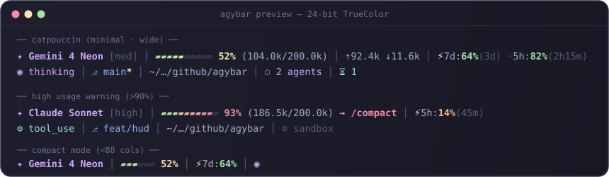

<div align="center">


**Google Antigravity CLI (`agy`)를 위한 초고속·고감도·무의존성 Go 상태바 및 실시간 사용량 모니터.**

<p>
  <a href="https://github.com/zhouyg1992/agybar/releases"></a>
  <a href="./LICENSE"></a>
  <a href="https://go.dev/"></a>
  
  <a href="https://github.com/zhouyg1992/agybar/actions/workflows/ci.yml"></a>
</p>

<p>
  <a href="./README.md">English</a> ·
  <a href="./README.zh-CN.md">简体中文</a> ·
  <a href="./README.ja.md">日本語</a> ·
  <strong>한국어</strong>
</p>



</div>

---

## 주요 기능

- **무의존성 & 밀리초 단위 실행** — 단일 정적 Go 바이너리로 `agy`의 반응 속도를 전혀 저하시키지 않습니다.
- **엄선된 4가지 24-bit TrueColor 테마** — `catppuccin`(기본), `tokyo-night`, `nord`, `mono`.
- **3가지 비주얼 스타일** — `minimal`(순수 유니코드로 모든 터미널에서 즉시 작동), `badge`(Nerd Font 없이도 작동하는 범용 컬러 배지), `pill`(Nerd Font / iTerm2 Powerline 둥근 캡슐 스타일).
- **3가지 그라데이션 프로그레스 바** — `blocks`(`▰▱`), `smooth`(`━╸─`), `braille`(`⣿⣤⣀`). 사용량에 따라 색상이 자연스럽게 변하며 `90%` 이상일 때 자동으로 `→ /compact`를 안내합니다.
- **반응형 레이아웃** — `terminal_width`를 감지해 넓은 화면에서는 2줄, 좁은 창(`<88` 컬럼)에서는 자동으로 1줄 컴팩트 모드로 축소됩니다.
- **풍부한 `agy` 텔레메트리** — 모델 및 추론 강도, 컨텍스트 사용률 및 토큰 카운트(`↑in ↓out`), 모델별 쿼터 잔량 및 리셋 카운트다운, 에이전트 상태, Git 브랜치, 서브에이전트 수, 백그라운드 작업 및 샌드박스 표시.

---

## 설치 방법

### 방법 1: 원라인 설치 스크립트 (권장)

GitHub Releases에서 최신 프리빌드 바이너리(SHA-256 검증 포함, Go 불필요)를 다운로드하고 `~/.gemini/antigravity-cli/settings.json` 설정 및 `agy` 플러그인 등록을 자동으로 완료합니다:

```bash
curl -fsSL https://raw.githubusercontent.com/zhouyg1992/agybar/main/install.sh | sh
```

설치 후 `agy`를 재시작하세요.

### 방법 2: `agy plugin install` + 채팅에서 활성화

```bash
agy plugin install https://github.com/zhouyg1992/agybar
```

이후 `agy`를 열고 **"enable agybar"** 라고 입력하면 내장 스킬이 자동으로 빌드 및 설정을 완료합니다.

### 방법 3: `go install` / 수동 설정

```bash
go install github.com/zhouyg1992/agybar/cmd/agybar@latest
```

`~/.gemini/antigravity-cli/settings.json`에 다음 항목을 추가하세요:

```json
{
  "statusLine": {
    "type": "command",
    "command": "agybar",
    "enabled": true,
    "padding": 0,
    "stack_with_default": false
  }
}
```

---

## 커스터마이징

### CLI 명령어

```bash
agybar preview             # 모든 테마, 경고 표시, 컴팩트 모드, pill 스타일 미리보기
agybar theme tokyo-night   # 테마 변경 (catppuccin | tokyo-night | nord | mono)
agybar style badge          # 스타일 변경 (minimal | badge | pill)
agybar bar smooth          # 프로그레스 바 변경 (blocks | smooth | braille)
agybar sep dot             # 구분자 변경 (pipe | dashed | dot | square | none | <custom>)
agybar config              # 현재 설정 확인
```

설정은 `~/.config/agybar/config.json`에 저장되며 `agy` 재시작 없이 다음 갱신 시 즉시 반영됩니다.

---

## 디버깅

`agy`가 전달하는 원본 JSON 페이로드를 확인하려면 `AGYBAR_DEBUG=1`을 설정하세요. 최신 페이로드가 `/tmp/agybar-last-payload.json`에 저장됩니다.

---

## 라이선스

[MIT](./LICENSE)
