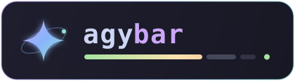
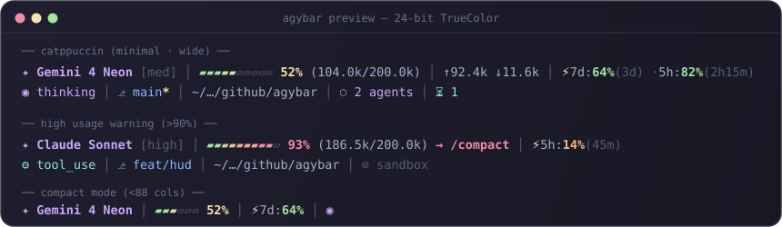

<div align="center">



**A fast, aesthetic, zero-dependency Go statusline & real-time usage bar for Google Antigravity CLI (`agy`).**

<p>
  <a href="https://github.com/zhouyg1992/agybar/releases"></a>
  <a href="./LICENSE"></a>
  <a href="https://go.dev/"></a>
  
  <a href="https://github.com/zhouyg1992/agybar/actions/workflows/ci.yml"></a>
</p>

<p>
  <strong>English</strong> ·
  <a href="./README.zh-CN.md">简体中文</a> ·
  <a href="./README.ja.md">日本語</a> ·
  <a href="./README.ko.md">한국어</a>
</p>



</div>

---

## Features

- **Zero dependencies, millisecond startup** — Single static Go binary; renders in a few milliseconds without slowing down `agy`.
- **7 curated 24-bit TrueColor themes** — `catppuccin` (default), `tokyo-night`, `nord`, `gruvbox`, `rose-pine`, `everforest`, and `mono`.
- **3 visual styles** — `minimal` (pure Unicode, works out of the box in any terminal), `badge` (universal colored badges, no Nerd Font required), and `pill` (rounded capsules for Nerd Font or iTerm2 built-in Powerline glyphs).
- **3 gradient progress bar styles** — `blocks` (`▰▱`), `smooth` (`━╸─`), and `braille` (`⣿⣤⣀`) with semantic color transitions (`green → yellow → peach → red`, plus an automatic `→ /compact` hint at `≥90%`).
- **Responsive layout** — Uses `terminal_width` to render 2 spacious lines on wide terminals and automatically collapse to 1 compact line on narrow panes (`<88` columns).
- **Rich `agy` statusline data** — Model & effort level, context window usage & token counters (`↑in ↓out`), model quota buckets with reset countdowns, agent state, Git branch/dirty status, active subagents, background tasks, artifacts, sandbox indicator, and execution mode (`plan` / `auto` / `accept-edits`).

---

## Installation

### Option 1: One-Line Installer (Recommended)

Downloads the latest prebuilt binary from GitHub Releases (with SHA-256 verification), configures `~/.gemini/antigravity-cli/settings.json`, and registers the `agy` plugin:

```bash
curl -fsSL https://raw.githubusercontent.com/zhouyg1992/agybar/main/install.sh | sh
```

Then restart `agy`.

### Option 2: `agy plugin install` + Activate in Chat

```bash
agy plugin install https://github.com/zhouyg1992/agybar
```

Then open `agy` and say **"enable agybar"** — the bundled skill will build the binary and configure `settings.json` for you.

### Option 3: `go install` / Manual Setup

```bash
go install github.com/zhouyg1992/agybar/cmd/agybar@latest
```

Add the `statusLine` block to `~/.gemini/antigravity-cli/settings.json`:

```json
{
  "statusLine": {
    "type": "command",
    "command": "agybar",
    "enabled": true,
    "padding": 0,
    "stack_with_default": false
  }
}
```

*(If `agybar` is not in your `PATH`, use the full binary path such as `~/.local/bin/agybar`.)*

---

## Customization

### CLI Commands

| Command | Description |
| :--- | :--- |
| `agybar preview` | Preview all themes, high-usage warnings, compact mode, and pill style |
| `agybar theme <name>` | Switch theme: `catppuccin`, `tokyo-night`, `nord`, `gruvbox`, `rose-pine`, `everforest`, `mono` |
| `agybar style <style>` | Switch style: `minimal` (default), `badge` (universal), or `pill` (Nerd Font / iTerm2 Powerline) |
| `agybar bar <style>` | Switch progress bar: `blocks`, `smooth`, `braille` |
| `agybar sep <preset\|text>` | Switch `minimal` separator: `pipe` (`│`), `dashed` (`┊`), `dot` (`•`), `square` (`▪`), `none` (blank), or custom text |
| `agybar config` | Show active configuration and config file path |
| `agybar version` | Print version |

### Configuration File

Settings are persisted at `~/.config/agybar/config.json` (respects `XDG_CONFIG_HOME`):

```json
{
  "theme": "catppuccin",
  "style": "minimal",
  "bar_style": "blocks",
  "separator": "pipe",
  "show_tokens": true,
  "show_quota": true,
  "show_second": true,
  "compact_at": 88
}
```

---

## Debugging

To inspect the raw JSON payload that `agy` pipes into `agybar`, run with `AGYBAR_DEBUG=1`:

```json
{
  "statusLine": {
    "type": "command",
    "command": "AGYBAR_DEBUG=1 agybar",
    "enabled": true
  }
}
```

The latest payload will be dumped to `/tmp/agybar-last-payload.json`.

---

## License

[MIT](./LICENSE)
