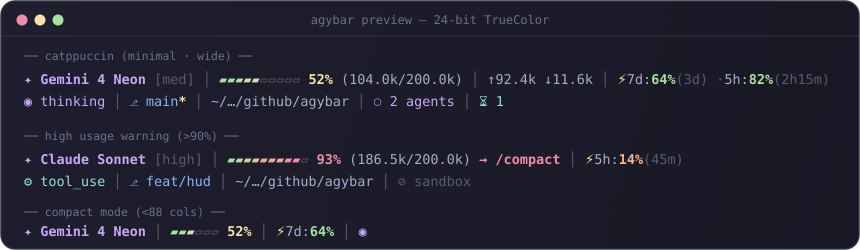

<div align="center">


**面向 Google Antigravity CLI (`agy`) 的高性能、高颜值、零依赖 Go 实时用量与状态栏插件。**

<p>
  <a href="https://github.com/zhouyg1992/agybar/releases"></a>
  <a href="./LICENSE"></a>
  <a href="https://go.dev/"></a>
  
  <a href="https://github.com/zhouyg1992/agybar/actions/workflows/ci.yml"></a>
</p>

<p>
  <a href="./README.md">English</a> ·
  <strong>简体中文</strong> ·
  <a href="./README.ja.md">日本語</a> ·
  <a href="./README.ko.md">한국어</a>
</p>



</div>

---

## 核心特性

- **零依赖、毫秒级启动** — 纯 Go 编译的单文件二进制，每次状态刷新仅需几毫秒，绝不卡顿 `agy`。
- **4 套精选 24-bit TrueColor 主题** — `catppuccin`（默认）、`tokyo-night`、`nord`、`mono`。
- **3 种视觉风格** — `minimal`（纯 Unicode，无需特殊字体，任意终端开箱即美）、`badge`（通用纯色徽章，无需 Nerd Font）与 `pill`（圆角胶囊风格，需 Nerd Font 或 iTerm2 内置 Powerline）。
- **3 种渐变进度条** — `blocks`（`▰▱`）、`smooth`（`━╸─`）、`braille`（`⣿⣤⣀`），随占比平滑变色（`绿 → 黄 → 橙 → 红`，超过 `90%` 自动提示 `→ /compact`）。
- **真正的响应式布局** — 读取 `terminal_width`，宽屏优雅展示双行，窄屏（`<88` 列）自动折叠为紧凑单行，不换行炸版。
- **完整 `agy` 遥测指标** — 当前模型与思维档位、上下文窗口占比与 Token 计数（`↑in ↓out`）、各模型配额剩余与重置倒计时、Agent 运行状态、Git 分支与脏标记、子代理数、后台任务数、产物数与沙箱标识。

---

## 安装方式

### 方式 1：一行命令安装（推荐）

直接从 GitHub Releases 下载对应平台的预编译二进制（带 SHA-256 校验，无需安装 Go），安全写入 `~/.gemini/antigravity-cli/settings.json` 并注册 `agy` 插件：

```bash
curl -fsSL https://raw.githubusercontent.com/zhouyg1992/agybar/main/install.sh | sh
```

安装完成后重启 `agy` 即可生效。

### 方式 2：`agy plugin install` + 对话内激活

```bash
agy plugin install https://github.com/zhouyg1992/agybar
```

随后打开 `agy` 并说一句 **“启用 agybar”**，内置 Skill 会自动帮你编译并配置好 `settings.json`。

### 方式 3：`go install` / 手动配置

```bash
go install github.com/zhouyg1992/agybar/cmd/agybar@latest
```

在 `~/.gemini/antigravity-cli/settings.json` 中加入 `statusLine` 配置：

```json
{
  "statusLine": {
    "type": "command",
    "command": "agybar",
    "enabled": true,
    "padding": 0,
    "stack_with_default": false
  }
}
```

*（如果 `agybar` 不在 `PATH` 中，请填写完整路径，例如 `~/.local/bin/agybar`。）*

---

## 个性化配置

### CLI 子命令

切换主题或风格后**无需重启 `agy`**，下次状态栏刷新即刻生效：

| 命令 | 说明 |
| :--- | :--- |
| `agybar preview` | 在终端预览全部主题、高占用告警、窄屏模式与胶囊风格 |
| `agybar theme <name>` | 切换主题：`catppuccin`、`tokyo-night`、`nord`、`mono` |
| `agybar style <style>` | 切换风格：`minimal`（默认）、`badge`（通用徽章）或 `pill`（需 Nerd Font / iTerm2 Powerline） |
| `agybar bar <style>` | 切换进度条：`blocks`、`smooth`、`braille` |
| `agybar config` | 查看当前生效配置与配置文件路径 |
| `agybar version` | 查看版本号 |

### 配置文件

配置持久化在 `~/.config/agybar/config.json`（兼容 `XDG_CONFIG_HOME`）：

```json
{
  "theme": "catppuccin",
  "style": "minimal",
  "bar_style": "blocks",
  "show_tokens": true,
  "show_quota": true,
  "show_second": true,
  "compact_at": 88
}
```

---

## 调试模式

如需查看 `agy` 实际传入 `agybar` 的原始 JSON 数据，可在配置中加上 `AGYBAR_DEBUG=1`：

```json
{
  "statusLine": {
    "type": "command",
    "command": "AGYBAR_DEBUG=1 agybar",
    "enabled": true
  }
}
```

最新一次的原始 JSON 会被保存到 `/tmp/agybar-last-payload.json`。

---

## 开源协议

[MIT](./LICENSE)
